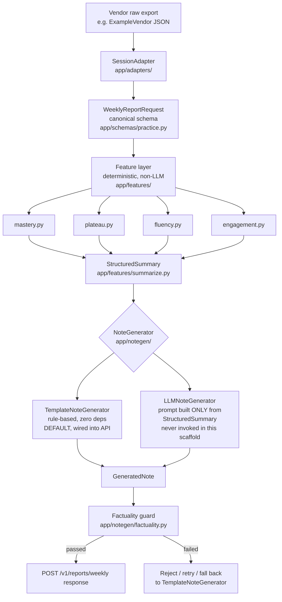

# Architecture

## Pipeline

## Why the pipeline is shaped this way

**Adapter boundary.** Every ed-tech vendor's raw export has its own field
names, nesting, and units. `SessionAdapter` (an ABC in
`app/adapters/base.py`) exists so that nothing past this point in the
pipeline ever needs to know a vendor's raw shape. The one concrete
implementation, `ExampleVendorAdapter`, demonstrates the mapping without
turning this scaffold into an adapter marketplace.

**Feature layer boundary.** `app/features/` is pure, deterministic Python:
no LLM calls, no randomness, no network access. Given the same
`WeeklyReportRequest` and the same historical mastery/session data, it
always produces the same `StructuredSummary`. This is what makes the
system's output auditable -- a partner engineer (or ProgressNote's own
developer) can look at any field on `StructuredSummary` and know exactly
which function produced it and why.

**The StructuredSummary boundary is the trust boundary.** Everything
before `StructuredSummary` can be as messy as real practice data
actually is. Everything after it -- the note generator, LLM or not --
operates in a closed world: the exact set of fields on
`StructuredSummary` and nothing else. See
`docs/adr/0001-structured-summary-not-raw-logs-to-llm.md` for the full
reasoning.

**Factuality guard.** Whether a note came from `TemplateNoteGenerator`
(which cannot fabricate anything, by construction) or `LLMNoteGenerator`
(which, being an LLM, in principle could), every generated note passes
through `check_factuality()` before the API returns it. The guard
extracts skill-area mentions and numeric claims from the note text and
verifies each one appears somewhere on the `StructuredSummary` object.
A note that fails this check is a note the caller should not show a
parent as-is.

## Data model

`GeneratedReport` (`app/db/models.py`) persists each generated note --
`student_id`, `period_start`/`period_end`, `note_text`, `next_focus`,
`factuality_passed`, `created_at` -- so a partner can retrieve report
history for a student. This scaffold does not yet persist mastery-history
or session-history tables; a production version would add those so that
`previous_snapshot` and `prior_period_stats` in
`app/api/v1/router.py` come from real history instead of an empty
baseline.
